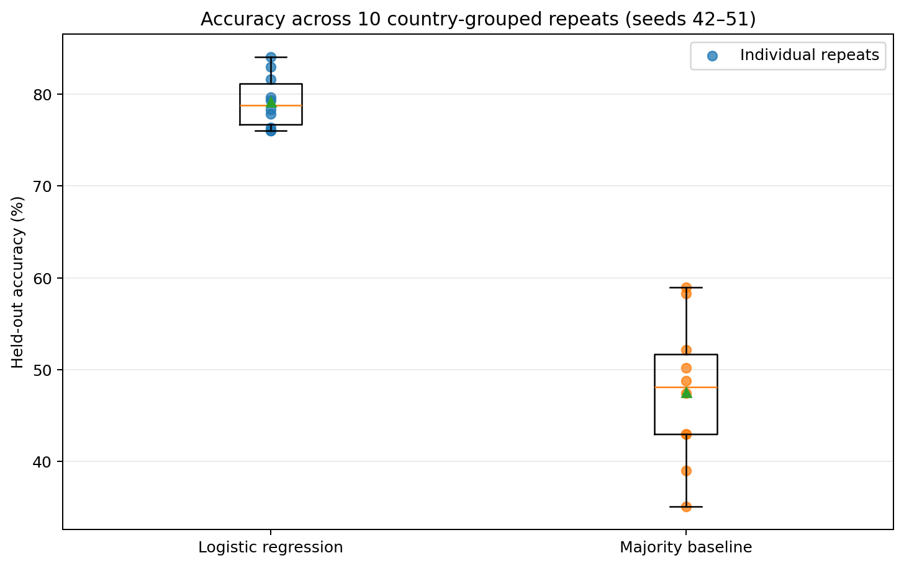

# Phase 6 — Repeated country-grouped testing

**Status:** Repeated testing and the complementary five-fold GroupKFold evaluation were executed. Phase 6 remains open pending group review; this report does not mark it complete.

## Dataset and protocol

The attached workbook contains 2,295 rows. Complete modelling cases: 2,111 country-year rows across 147 countries/areas. The existing four predictors and Logistic Regression pipeline were retained: `log1p(clean_energy_finance_all_usd_m)`, `elec_access_total_pct`, `log1p(re_capacity_all_w_per_capita)`, and `year`; `StandardScaler` followed by `LogisticRegression(max_iter=2000, class_weight="balanced", random_state=42)`. The high class is renewable share strictly above the median calculated from the current training partition. The same training-derived median was applied to that partition's held-out rows. All splits were grouped by ISO3 country; all overlap checks returned zero.

## Ten repeated GroupShuffleSplit evaluations

One 25% country holdout was run for each seed 42–51. Each repeat held out 37 countries and trained on 110 countries. Results are percentages.

| Seed | Train median | Test rows | Accuracy | Precision | Recall | F1 | Baseline accuracy |
|---:|---:|---:|---:|---:|---:|---:|---:|
| 42 | 25.01 | 533 | 75.98 | 87.45 | 70.77 | 78.23 | 39.02 |
| 43 | 27.70 | 526 | 78.33 | 96.84 | 58.40 | 72.86 | 50.19 |
| 44 | 27.36 | 533 | 82.93 | 92.38 | 73.57 | 81.91 | 47.47 |
| 45 | 27.53 | 531 | 79.28 | 90.50 | 66.54 | 76.69 | 48.78 |
| 46 | 29.52 | 532 | 77.82 | 74.07 | 72.07 | 73.06 | 58.27 |
| 47 | 28.18 | 533 | 84.05 | 81.95 | 85.49 | 83.69 | 52.16 |
| 48 | 26.18 | 528 | 81.63 | 90.80 | 75.42 | 82.40 | 42.99 |
| 49 | 24.15 | 530 | 76.04 | 91.57 | 69.48 | 79.01 | 35.09 |
| 50 | 26.18 | 528 | 76.33 | 84.11 | 72.09 | 77.64 | 42.99 |
| 51 | 29.66 | 531 | 79.66 | 79.57 | 67.89 | 73.27 | 58.95 |

Mean ± sample SD; min–max (percentages):

| Model | Accuracy | Precision | Recall | F1 |
|---|---:|---:|---:|---:|
| Logistic regression | 79.20 ± 2.88 (75.98–84.05) | 86.92 ± 6.91 (74.07–96.84) | 71.17 ± 6.90 (58.40–85.49) | 77.87 ± 3.99 (72.86–83.69) |
| Majority baseline | 47.59 ± 7.77 (35.09–58.95) | 0 ± 0 | 0 ± 0 | 0 ± 0 |

The original 75.98% result (seed 42) was the **lowest accuracy** among the ten splits, not an unusually favourable result. The repeated mean was 79.20% ± 2.88 percentage points. Logistic regression exceeded the baseline in all ten repeats. A roughly 50% chance-level reference is appropriate as a rough guide for a median-defined binary label, but held-out class prevalence varies by country split. The deterministic majority baseline predicted low in every repeat: training labels tied in 5/10 splits and had a one-observation low-class majority in the other 5/10. Thus its precision, recall and F1 were zero because it never predicted high. Repeated holdouts reuse some countries across repeats and are not independent external studies.



## Complementary five-fold GroupKFold

`GroupKFold(n_splits=5)` was run without shuffling. Every country appeared in exactly one held-out fold; country overlap was zero in every fold. The training median was recalculated within each fold.

| Fold | Train median | Train rows/countries | Test rows/countries | Accuracy | Precision | Recall | F1 | Baseline accuracy |
|---:|---:|---:|---:|---:|---:|---:|---:|---:|
| 1 | 27.18 | 1680/117 | 431/30 | 75.64 | 99.24 | 55.56 | 71.23 | 45.71 |
| 2 | 25.53 | 1682/117 | 429/30 | 78.55 | 90.87 | 72.14 | 80.43 | 38.93 |
| 3 | 27.59 | 1694/118 | 417/29 | 75.06 | 75.71 | 75.00 | 75.36 | 49.16 |
| 4 | 27.32 | 1694/118 | 417/29 | 85.13 | 94.02 | 77.23 | 84.80 | 46.28 |
| 5 | 32.80 | 1694/118 | 417/29 | 83.21 | 60.87 | 73.68 | 66.67 | 77.22 |

Mean ± sample SD; min–max (percentages): logistic-regression accuracy 79.52 ± 4.50 (75.06–85.13), precision 84.14 ± 15.68 (60.87–99.24), recall 70.72 ± 8.68 (55.56–77.23), and F1 75.70 ± 7.19 (66.67–84.80). Baseline accuracy was 51.46 ± 14.88 (38.93–77.22); baseline precision, recall and F1 were zero. All five training folds had exact low/high ties, so the documented low tie-break predicted low. The GroupKFold accuracy mean is close to the ten-repeat mean, supporting the view that seed 42 was not unusually favourable in these tested partitions. Precision varies more under GroupKFold, so performance is not equally stable across metrics.

## Error analysis across ten repeated holdouts

Counts aggregate held-out prediction exposures across repeats; the same country-year may appear in more than one test split. Denominators are exposures, not unique source rows.

The country error CSV retains the 30 countries with the largest misclassification counts. Four consistently misclassified countries were: Pakistan 56/56 (56 false negatives); Democratic People's Republic of Korea 42/42 (42 false positives); Gabon 42/42 (42 false negatives); and Comoros 30/30 (30 false negatives). **Hypothesis:** the four predictors and one pooled linear boundary may not represent country-specific energy-system characteristics, policies, financing composition or source-estimation differences. This is a possible explanation, not an established cause.

Year error rates were relatively close during 2020–2023: 2020 25.41% (94/370), 2021 26.22% (97/370), 2022 22.97% (85/370), and 2023 26.22% (97/370). **Hypothesis:** a single linear year feature may not capture all time-varying relationships. These small differences do not establish temporal deterioration. The 2024 rate is 20.93% from 129 exposures, versus about 370 for most other years.

### Continent-level false negatives and false positives

| Continent | Exposures | Errors | Error rate | False negatives | False positives | FN − FP |
|---|---:|---:|---:|---:|---:|---:|
| Asia | 1,271 | 353 | 27.77% | 246 | 107 | 139 |
| Africa | 1,990 | 283 | 14.22% | 184 | 99 | 85 |
| South America | 507 | 142 | 28.01% | 124 | 18 | 106 |
| North America | 733 | 126 | 17.19% | 92 | 34 | 58 |
| Oceania | 510 | 114 | 22.35% | 80 | 34 | 46 |
| Europe | 294 | 85 | 28.91% | 75 | 10 | 65 |

False negatives exceed false positives in all six continent aggregates. This supports a limited descriptive statement that the model has net high-class underprediction in these held-out exposures; it does not establish a regional causal explanation. Europe's 28.91% error rate is based on only 294 exposures and should be interpreted cautiously. **Hypothesis:** regional heterogeneity not represented by the predictors may contribute to the differences; exposure counts also affect absolute error totals.

The complementary GroupKFold continent counts show the same direction:

| Continent | Test exposures | False negatives | False positives |
|---|---:|---:|---:|
| Asia | 524 | 92 | 40 |
| Africa | 778 | 55 | 41 |
| Oceania | 240 | 50 | 14 |
| North America | 288 | 45 | 11 |
| South America | 169 | 34 | 12 |
| Europe | 112 | 30 | 9 |

## Reproducibility, privacy and phase status

Run from repository root with the workbook supplied locally to Group 8:

```bash
python outputs/phase6_repeated_testing/phase6_repeated_country_grouped.py --workbook data/Group_08_Dataset.xlsx --output-dir outputs/phase6_repeated_testing --figure-dir outputs/figures --repeats 10 --first-seed 42
```

The script uses pandas/openpyxl to read the private workbook, plus NumPy, scikit-learn and Matplotlib. The pinned root `requirements.txt` contains these dependencies. The workbook and raw source rows are not included in the result folder or proposed commit. CSVs contain repeat/fold metrics and aggregated country/year/continent error counts, not the underlying source rows. **Phase 6 remains open pending group review and any requested rerun.**

## Files in this results folder

- `phase6_repeated_country_grouped.py` — execution script.
- `phase6_console_output.txt` — run output.
- `phase6_repeated_split_metrics.csv` and `phase6_repeated_summary_statistics.csv` — repeated split results.
- `phase6_repeated_split_audit.csv` — thresholds, country separation and baseline tie audits.
- `phase6_repeated_country_error_analysis.csv`, `phase6_repeated_year_error_analysis.csv`, `phase6_repeated_continent_error_analysis.csv` — aggregated error analyses.
- `phase6_groupkfold_fold_metrics.csv`, `phase6_groupkfold_summary_statistics.csv`, `phase6_groupkfold_fold_audit.csv`, `phase6_groupkfold_continent_error_analysis.csv` — GroupKFold metrics, audit and continent errors.
